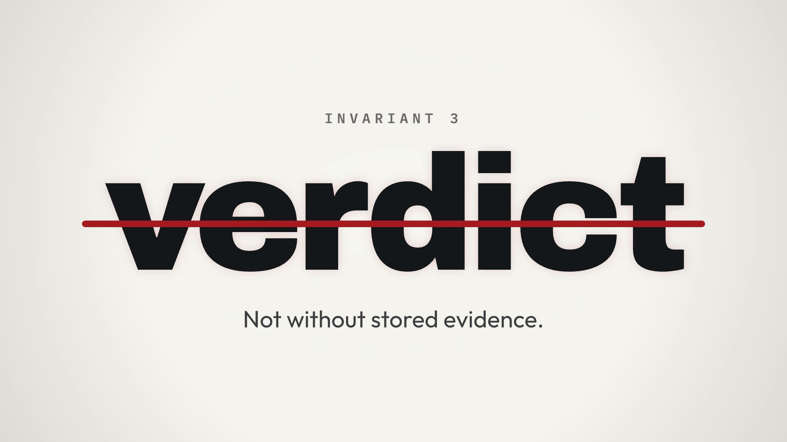
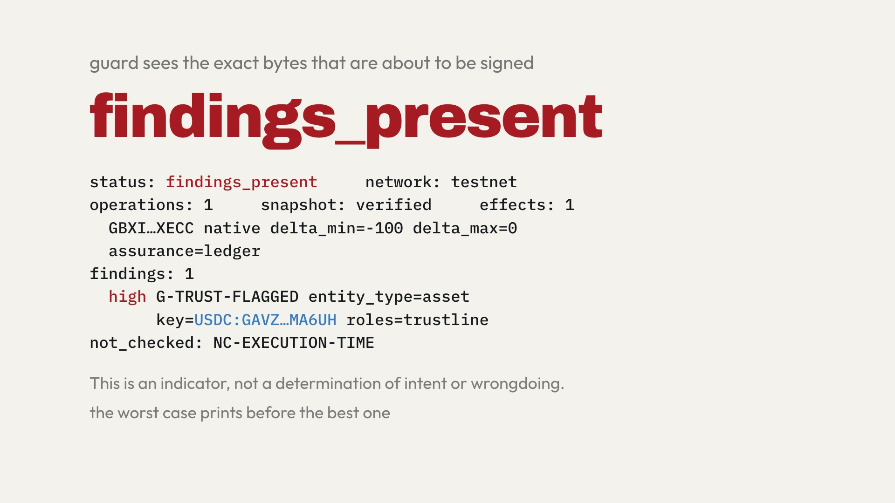

# SoroSentinel

Security tooling for the Stellar ecosystem. It **advises**: it never controls the network, never touches a private key, and never signs anything for you.

Stellar's classic layer has no arbitrary code, so the interesting risks are narrower than general malware: a contract that can replace its own code, a transaction that quietly adds a signer, an asset with a familiar code issued by somebody else, or a domain that no longer matches the issuer's record. SoroSentinel analyzes those and describes what it observed.

## Watch it work

[](https://github.com/SoroSentinel/Sorosentinel-intel/blob/main/media/demo-flow.mp4)

The film above shows the complete flow running across testnet in one command (`make demo`, 4 minutes 8 seconds, measured on 2026-11-01):
1. A look-alike asset is issued on testnet.
2. Ingestion records immutable evidence rows in the database.
3. The rule table evaluates the evidence and assigns a `caution` signal.
4. An Ed25519-signed snapshot is published.
5. The read API answers with the finding facts.
6. Guard analyzes the transaction envelope offline and returns `findings_present` with `G-TRUST-FLAGGED`.
7. A control transaction returns `no_issues_found`.

> [!NOTE]
> **Protocol 30 schedule notice:** Testnet upgrades to Protocol 30 on **2026-11-03 17:00 UTC**. During the 4.5-hour dependency cooldown until `go-stellar-sdk` v0.8.0 clears (2026-11-03 21:30 UTC), ingestion halts by design rather than guessing unknown XDR structures. See the [status page](status.html) for details.

## The three components, one pipeline

```
[ Soroban Contract WASM ]
           │
           ▼
[ sorosentinel-scan ] (Rust)
           │  ScanReport JSON
           ▼
[ sorosentinel-intel ] (Go) ◀── Stellar RPC Ledgers & SEP-1 Domains
           │  Ed25519 Signed Snapshot & Read API
           ▼
[ sorosentinel-guard ] (TypeScript SDK)
           ▲
           │  Raw XDR Envelope (Pre-Signing)
   [ Stellar Wallet / User ]
```

| Component | Language | Role | Repository |
|---|---|---|---|
| **Guard** | TypeScript | Pre-signing transaction analysis SDK for wallets. Intercepts XDR envelopes, simulates Soroban calls, derives worst-case net balance deltas, and verifies snapshots offline. | [sorosentinel-guard](https://github.com/SoroSentinel/Sorosentinel-guard) |
| **Intel** | Go | Evidence and threat intelligence backbone. Reads ledgers via Stellar RPC, validates SEP-1 home domains, computes reproducible rule-based signals, and publishes signed snapshots. | [sorosentinel-intel](https://github.com/SoroSentinel/Sorosentinel-intel) |
| **Scan** | Rust | Sandboxed static analysis library and CLI. Parses compiled Soroban contract WASM bytecode without network access or execution, validating SEP-41 interfaces and resource limits. | [sorosentinel-scan](https://github.com/SoroSentinel/Sorosentinel-scan) |

Data flows in one direction: **Scan → evidence → Intel → signed snapshot → Guard.** Repositories never import each other's internals; they communicate exclusively through versioned schemas owned by Intel.

## Quickstart guides by role

### For wallet integrators (Guard SDK)

Guard runs client-side in the wallet before a user signs. It derives the net balance effects per account and checks counterparties against offline snapshots:

```typescript
import { analyze } from "@sorosentinel/guard-core";

// Analyze transaction bytes before displaying the signing prompt
const report = await analyze(transactionEnvelopeXDR, {
  networkPassphrase: "Test SDF Network ; September 2015",
  rpcUrl: "https://soroban-testnet.stellar.org",
  snapshotPath: "./snapshots/latest.bin",
});

if (report.status === "findings_present") {
  // Show findings ordered by severity, worst-case balance deltas, and unexamined items
  console.log("Findings:", report.findings);
  console.log("Account Balance Deltas:", report.effects);
  console.log("Not Checked:", report.not_checked);
} else if (report.status === "no_issues_found") {
  console.log("No issues observed across checked rules.");
}
```

Detailed guide: [What Guard reports](reference/guard-findings.html).

### For contract authors and auditors (Scan CLI)

Scan inspects deployed Soroban contract WASM in a locked-down sandbox (`--network none`, 256 MiB RAM, seccomp filter). It outputs deterministic JSON and SARIF:

```bash
# Analyze contract bytecode locally
cargo run -p scan-cli -- path/to/contract.wasm --format json

# Or generate SARIF for CI workflows
cargo run -p scan-cli -- path/to/contract.wasm --format sarif
```

Detailed guide: [What Scan reports](reference/scan-indicators.html).

### For node operators and indexers (Intel API)

Intel runs ingestion workers that tail Stellar RPC ledgers, evaluate rule tables, and publish cryptographically signed snapshots:

```bash
# Start the Intel read API
go run ./cmd/intel-api -snapshot-dir ./snapshots -db "$INTEL_DATABASE_URL"

# Verify a downloaded snapshot offline with Ed25519 public key
# (See verifying-snapshots for test vectors and format spec)
```

Detailed guide: [Verifying a snapshot yourself](verifying-snapshots.html) and [What Intel publishes](reference/intel-signals.html).

## Core invariants

**Absence of a result is never reassurance.** If analysis fails, times out, or encounters an unknown operation or credential type, the answer is `partial` or `unanalyzable`. A tool that returns a clean result when it failed is worse than no tool. SoroSentinel never outputs "safe".

**No status without stored evidence.** Every signal points directly to the immutable database rows that produced it, along with the inspection timestamp (`as_of`) and ruleset version. Verdicts are a reproducible rule table over `(evidence, as_of, ruleset_version)` — never an arbitrary score or subjective guess.

**Public text is fixed and reviewed.** User-facing sentences come only from an approved registry of wording templates filled with observed facts. If a template cannot render exactly, the system fails closed, returning structured facts without prose.

**Money is integers.** Amounts are 7-decimal fixed-point integers (stroops). The system never uses floating-point arithmetic for balances or fees.

## Documentation & Reference

- [What Guard reports](reference/guard-findings.html) — 8 finding codes and 7 not-checked codes.
- [What Scan reports](reference/scan-indicators.html) — 7 capability indicators, interface validation rules, and caps.
- [What Intel publishes](reference/intel-signals.html) — 4 public signal names (`consistent`, `no_signals`, `caution`, `high_caution`).
- [Verifying a snapshot yourself](verifying-snapshots.html) — snapshot format specification and shared test vectors.
- [Project status](status.html) — verified testnet runs, test coverage, and Protocol 30 window.
- [How SoroSentinel compares](comparison.html) — StellarExpert, Assay, Stellar Agent Guard, contract scanners and transaction explainers.
- [GitHub Organization](https://github.com/SoroSentinel) — source code for Intel, Guard, and Scan.
